# Phone review before and after

Native viewport screenshots, fictional data only. Click a picture for its full size. The initial main checkout supplied the first six before pictures; the approval-message and wide-header pairs record the branch before and after those follow-up fixes. Themes are explicitly selected in the fixture.

| State | Before | After |
| --- | --- | --- |
| Caption save interrupted, iPhone SE, light. The old editor closed and showed the original caption. The new editor retains the words and explains the retry. | [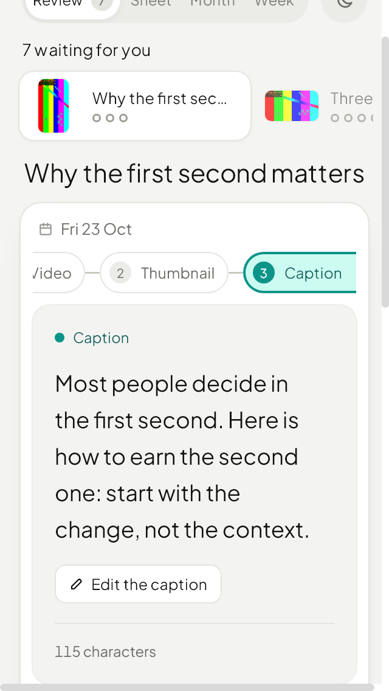](images/before-caption-offline-light.png) | [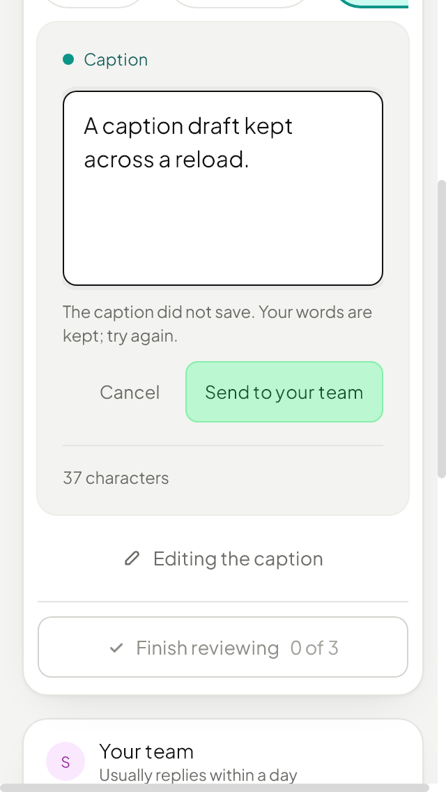](images/after-caption-offline-light.png) |
| Client review, iPhone SE, light. Controls and fields have phone-sized targets. | [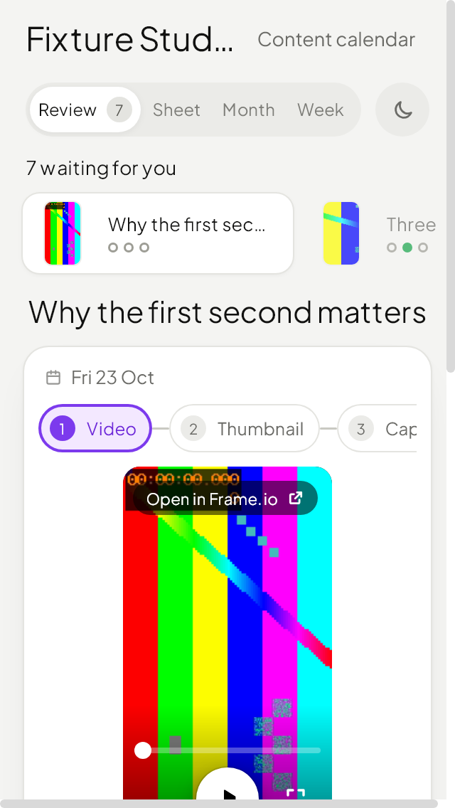](images/before-se-client-light.png) | [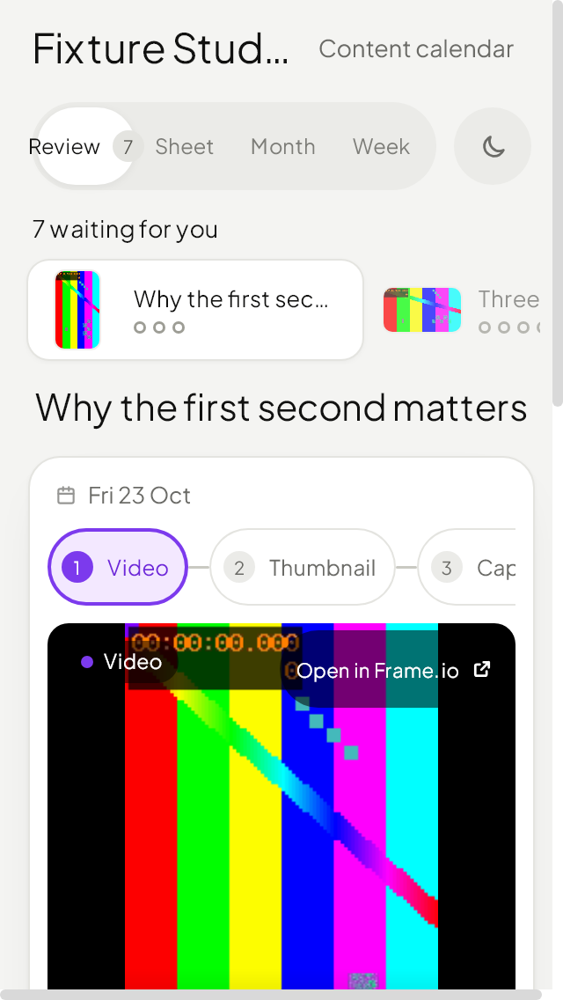](images/after-se-client-light.png) |
| Client composer, iPhone SE, light. Larger part chips, actions and type. | [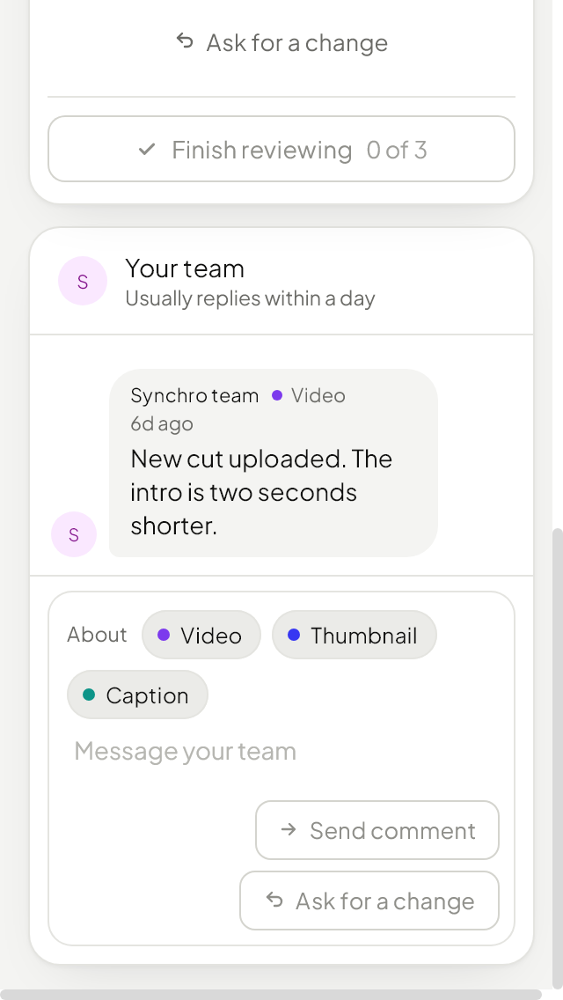](images/before-se-composer-light.png) | [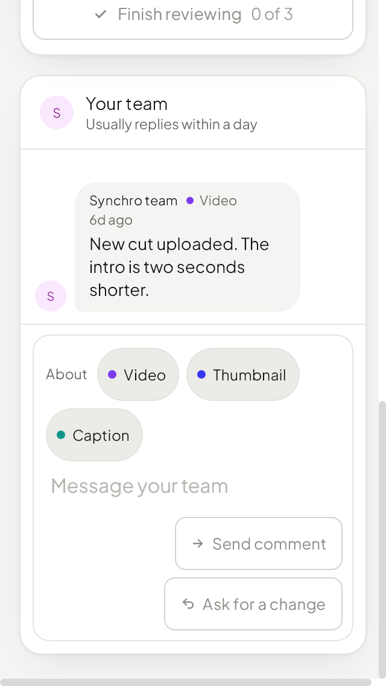](images/after-se-composer-light.png) |
| Staff review, iPhone SE, dark. The full post title and the review-round note fit. | [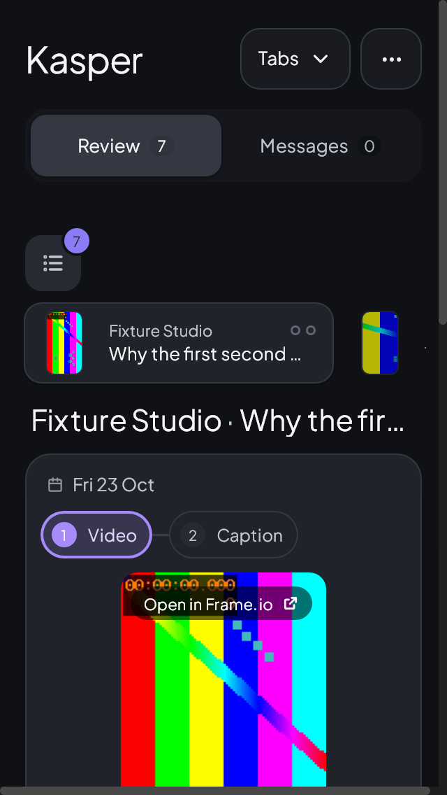](images/before-se-staff-dark.png) | [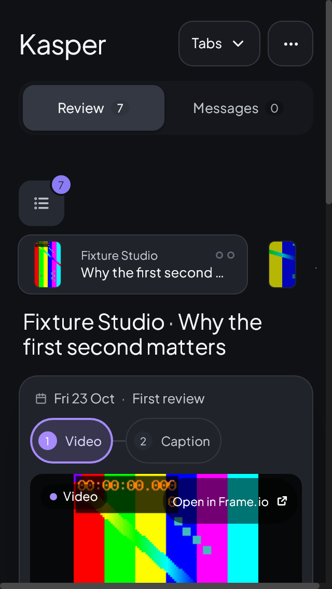](images/after-se-staff-dark.png) |
| Staff composer, iPhone SE, dark. Close card is available; the note field and send target are larger. | [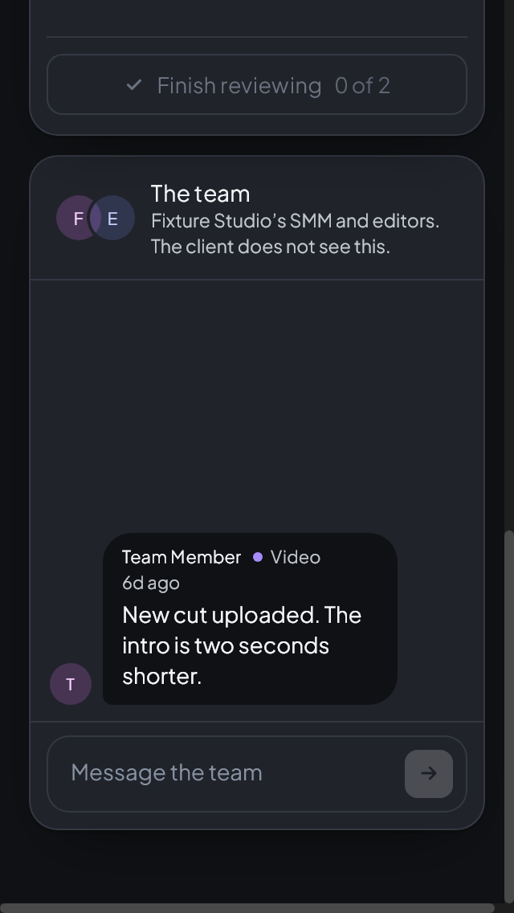](images/before-se-staff-composer-dark.png) | [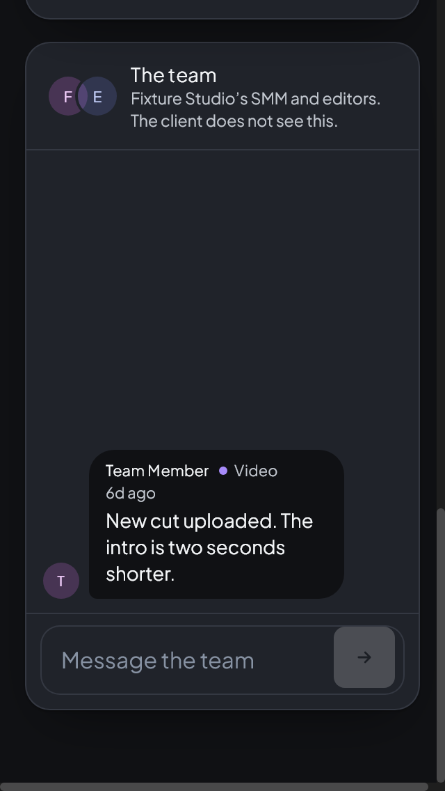](images/after-se-staff-composer-dark.png) |
| Pixel 7 landscape, light. The phone composer is reachable by scrolling the page instead of using the desktop side panel. | [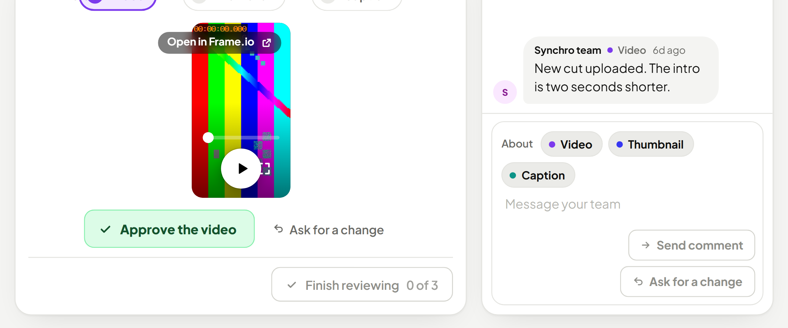](images/before-pixel-landscape-light.png) | [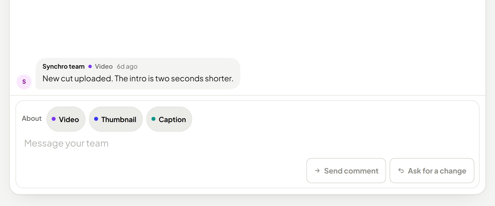](images/after-pixel-landscape-light.png) |
| Staff after approving and sending back, iPhone SE landscape, light. The approval message's Undo covered Finish; the message now sits at the safe top edge, leaving Finish clear. | [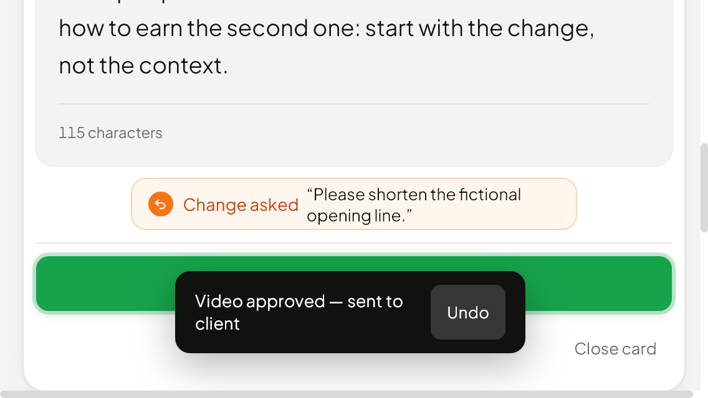](images/before-staff-landscape-toast-light.png) | [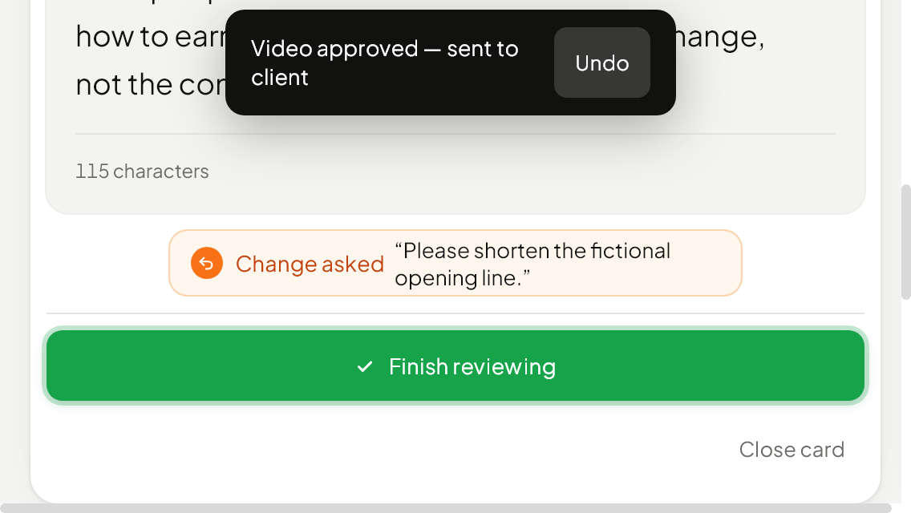](images/after-staff-landscape-toast-light.png) |
| Staff navigation, Pixel 7 landscape, light. The wider phone inherited 30–36 px desktop targets. They are now 44 px, with the same native navigation and menu scrolling. | [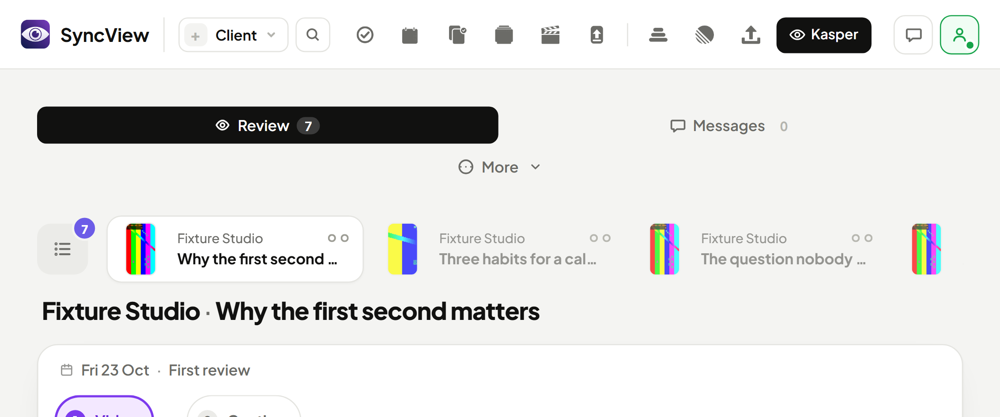](images/before-wide-header-light.png) | [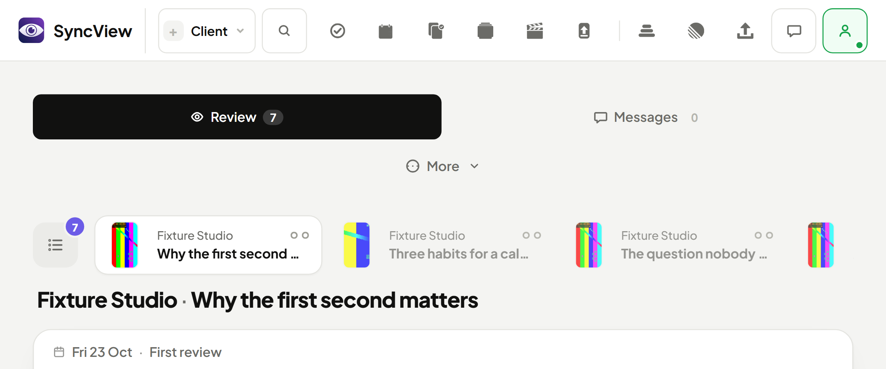](images/after-wide-header-light.png) |

The narrow inline player keeps play/pause, speed, mute and Full screen without overlapping. The timeline has a 44 px touch area; the picture is contained.

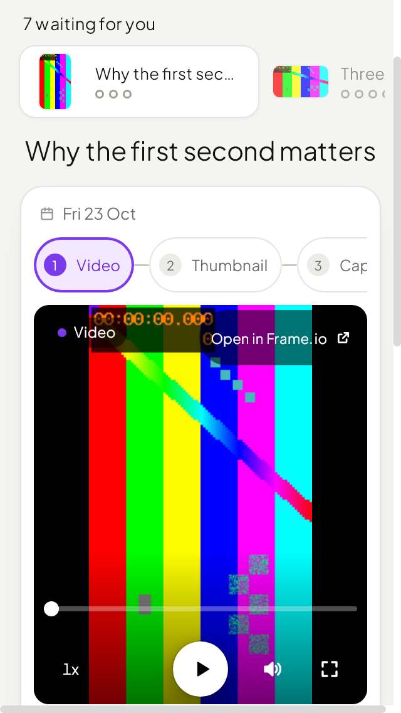
