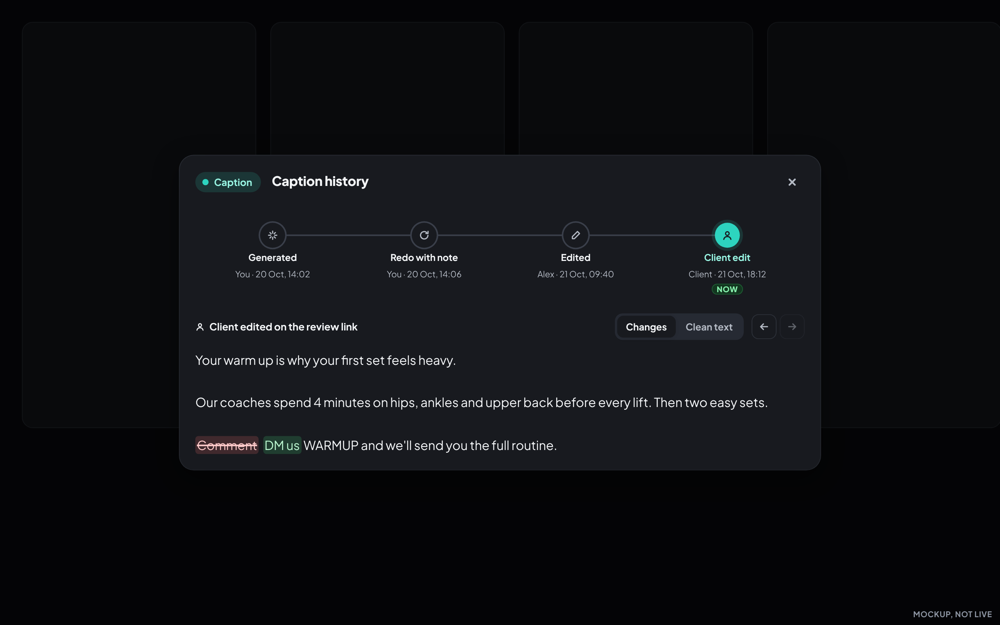
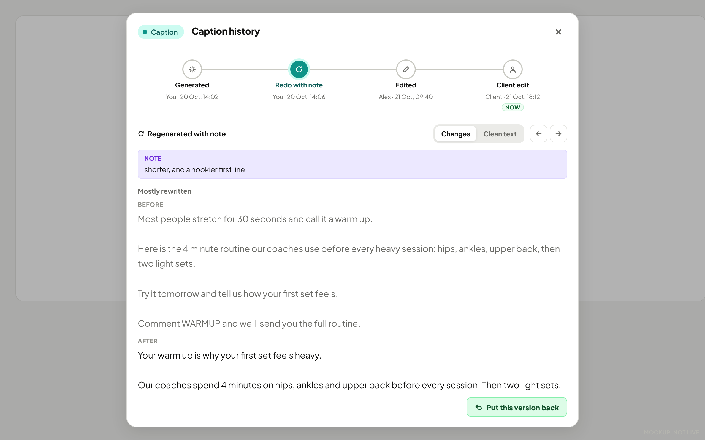
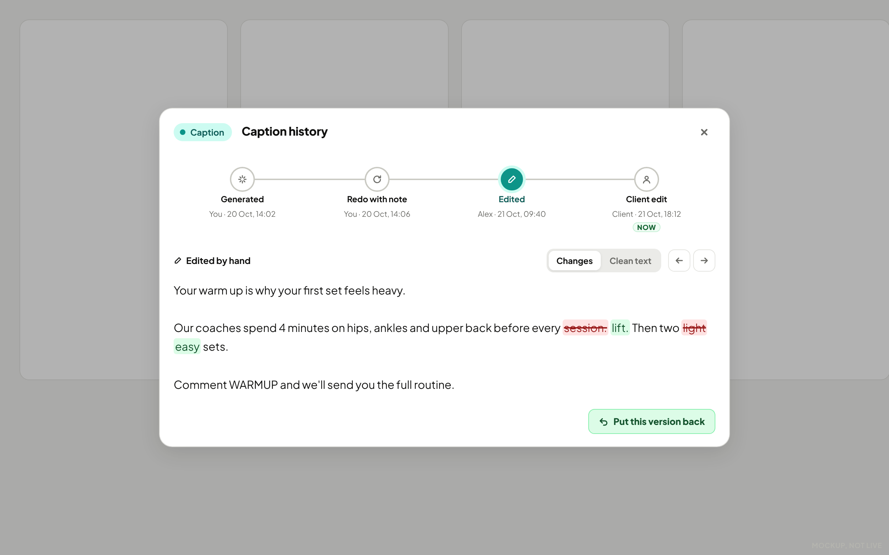
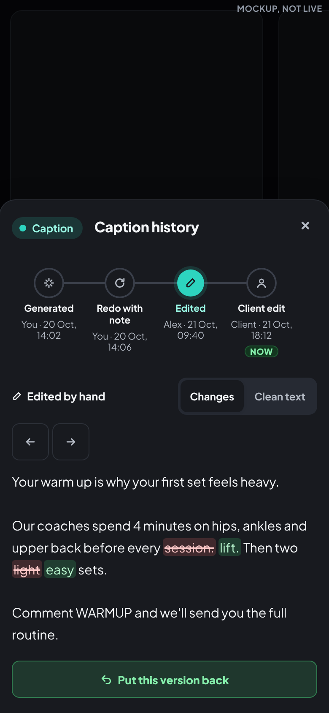
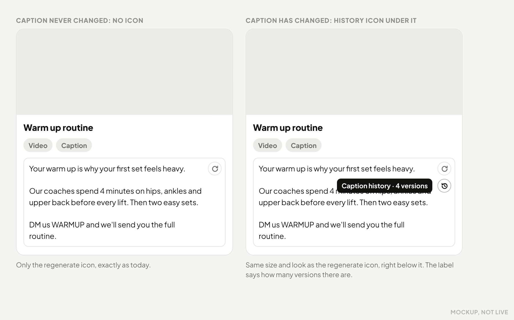

# Caption history on Calendar cards: plan and mockups (nothing built)

Session Versions, started 2026-10-23 20:22 UTC (`date -u`). Design only. Nothing here ships, and no
live data was changed. The mockups are static pages with a made-up post and made-up people.

Owner's ask (2026-10-23): after "Regenerate with a note" he cannot see how the caption changed. Once a caption
has changed, a small history icon sits just under the regenerate icon. It opens a pop-up in the look of the
review page's caption view: the versions, the differences highlighted, and a button that puts an older
version back.

## The chosen design (option C), as it looks

The caption now, after a client edit (only the changed words are marked):

A redo with your note (mostly rewritten, so before and after are shown whole):

A small hand edit, with "Put this version back":

On a phone:

Where it starts: the history icon under the regenerate icon on the card:

## 1. How a caption changes today (read from the code and the live database, 2026-10-23)

| Way | Code path | What saves it | Must create a version? |
|---|---|---|---|
| Staff types in the caption box | `textarea[data-fld=caption]` → `_calOnFieldBlur` / pending-edit flush (`src/index/170`, `180`) | `calendar-card-write` (every client since 2026-10-21) | Yes. One version per typing burst, not per keystroke (see "Grouping") |
| Generate (empty caption) | `_calGenerateCaption` → `caption-generate` writes the result to `caption_jobs` only; the page then types it into the box | same card saver | Yes, marked "Generated" |
| Regenerate with a note ("Redo with a note") | `_calRedoCaption` → `caption-generate` with `{ note, redo }`; `_calCapRedoApply` types the result into the box only if the box still holds the starting caption | same card saver | Yes, marked "Regenerated with note" **and the note is stored with it** |
| Client edits the caption on the review link | `195-review-stage` → `_calClientReviewCaptionEdit` (`170`) | `calendar-upsert` (client links still save there, and it is frozen) | Yes, marked "Client edited on the review link" |
| Kasper | Kasper's review writes notes and approvals, not caption text (no caption edit found in `305`/`330`) | n/a | Only if he ever edits through the card saver, and then like staff typing |
| Anything else (SQL, a repair script) | direct table write | n/a | Yes, marked "Changed outside SyncView" (the trigger below catches it) |

### What history already exists

- **`calendar_post_events`** (the card ledger): records caption *status*, caption *notes* and approvals, but
  **never the caption text**. No action stores the old or new words. Not usable as is.
- **`card_change_journal`** (trigger `card_change_journal_after` on `calendar_posts`, since 2026-09-17): stores the
  **whole row before and after every real change**, so the old caption text is there. Measured 2026-10-23:
  3,378 caption changes on 621 cards; 2,828 in the last 30 days; one card has 169. But:
  - it cannot say **who** or **how**: every row's database role is `service_role` (the savers write as the
    service), and it has no "this was a redo, here is the note";
  - **60% of caption changes are typing saves under 10 seconds apart** (2,016 of 2,757 follow-up changes), so read
    raw it would show dozens of near-identical versions;
  - it is 806 MB, holds every column of six tables, and is service-role read only. It is the recovery journal,
    and a browser feature should not lean on it.
- `caption_jobs` keeps the note and the generated text, but is pruned after a short time, so it cannot be the history.
- The review page already shows a client's caption edit in its conversation as "new caption, then the old one
  folded" (`195`, the `diff` block). That stays as it is.

So the old text exists, but not the who, the how or the note. **Recommendation: a small new append-only table,
backfilled once from `card_change_journal`.**

## 2. Plan

**Storage.** New table `caption_versions`:
`id, client, post_id, field ('caption' or 'caption_alt'), text, kind (generated | redo | typed | client | restored | outside),
note, restored_from (version id), actor, actor_role, created_at`.
Append-only: `revoke all ... from public, anon, authenticated, service_role` (all four named), then
`grant select, insert to service_role` only, plus a trigger that refuses UPDATE and DELETE. No browser key can
read or write it.

**How it is written.** A trigger on `calendar_posts` inserts a row whenever `caption` (or `caption_alt`) really
changes, so every path (both savers, SQL, future ones) is covered without touching the frozen `calendar-upsert`.
The *how* comes from the saver: the page sends `x-syncview-caption-origin` (`typed`, `generated`,
`redo` plus the note, `restored` plus the version id) to `calendar-card-write`, which passes it to the database
for that one write. A client-link save is recognised by its source (`calendar-upsert`, role client). No hint means
"Changed outside SyncView".

**Grouping (what the picker lists).** Every save is kept, but the list shows one entry per *burst*: saves by the
same person, the same way, less than 5 minutes apart, show as one version holding the last text of the burst.
A generate, a redo, a client edit and a restore always start a new entry. On the busiest card today this turns
169 saves into a list a person can read.

**Who and how line.** "Regenerated with note · You · Tue 20 Oct, 14:06", with the note shown in a bubble under
it. "Edited by hand · Alex", "Client edited on the review link · Client", "Put back from version 2 · You".

**Restore.** "Put this version back" types that text into the caption box the same way a redo does
(`_calCapTypeInto`), so the normal saver, its draft and its conflict checks run. That save becomes a *new*
version marked "Put back from version N". Nothing is overwritten or deleted. A toast says
"Version 2 is back in the caption · Undo" (Undo puts back the one before, again as a new version).

**Two tabs at once.** The pop-up reads fresh each time it opens. If the caption changes while it is open (another
tab, a teammate, the client), the pop-up shows "The caption changed while this was open" and the restore button
waits for a refresh instead of overwriting the newer words; the saver's own conflict check is the second guard.

**Reading.** Staff only, through a GET action on an existing staff Edge Function (e.g. `caption-generate`,
`action=caption_history`, the same pattern as its `cta_get`). Read only when the pop-up opens; the icon's
"has history" flag rides on the card data the Calendar already loads (a count, not the text).

**Which captions.** The main caption first (the redo only rewrites that one). `caption_alt` (the second
platform's caption) uses the same table and pop-up with a toggle, if wanted.

**What the client sees.** Nothing new (recommended). Clients already see their own edit in the review
conversation. Showing the agency's drafts and AI attempts to a client invites confusion.

**Retention.** Keep forever. At today's rate it is about 3,000 saves a month at roughly 0.7 kB each, so about
2 to 3 MB a month. A one-time backfill from `card_change_journal` (since 2026-09-17) gives older cards their
earlier versions, marked "Earlier change (who and how not recorded)".

**Cost.** No AI cost and no new service. One extra small insert per caption save, one read per pop-up open.
Build size: one migration (table, trigger, revokes, backfill), a header pass-through in `calendar-card-write`,
one read action, the icon and the pop-up in `180`, and offline browser tests. A migration means the merge lane
holds the functions until the migration is applied (see `docs/ops/EF_AUTO_DEPLOY.md`).

## 3. The word-by-word highlight, and when not to use it

A word diff reads well when a few words change ("Comment" → "DM us"). After a redo with a note most of the
caption is usually rewritten, and a word diff then becomes alternating red and green words nobody can read
(first draft of these mockups). So the pop-up:

- groups changed words into phrases (a short word like "is" between two changes joins the change);
- when more than about 60% of the words changed, says "Mostly rewritten" and shows Before and After whole.

## 4. Options

| Option | File | Idea |
|---|---|---|
| A. Side by side | `option-a-side-by-side.html` | Older on the left, newer on the right, a picker on each, red marks on the left, green on the right. Closest to the owner's first idea. Restore under the older column. |
| B. One column and a list | `option-b-inline-list.html` | List of versions on the left (newest at top, each with who, when, note, words changed); one column with inline marks; "What this change did" or "Compare with now". On a phone the list becomes a picker. |
| C. Step by step (recommended) | `option-c-steps.html` | A step strip, oldest left, newest right (like the review page's step bar). Each step shows the note that caused it and what it changed, with Changes or Clean text, arrows to walk through. |
| Entry point | `entry-point.html` | The history icon under the regenerate icon (desktop), and in the row under the box on a staff phone. |

**Recommendation: C.** It answers the owner's actual question, "what did my note do?", in one look: the note,
then exactly what changed because of it. It keeps his left-to-right order without a dropdown, works on a phone
by scrolling the strip, and every version is one click away. A is the best when comparing two far-apart
versions, and C can offer "Compare with now" later if that is wanted.

Screenshots: `screenshots/` (light and dark, desktop 1280 and phone 390). Made with
`node docs/syncview-design/mockups/caption-history/make-screenshots.js`, offline Chromium, no network.

## Owner's review (2026-10-23): C chosen, minus repeated text

The owner picked C and asked to remove text that says the same thing twice, keeping the layout. Removed:
the subtitle (post name, date, "oldest on the left"), the who and when beside the kind of change (the step
strip shows them), "in the caption now" (the strip's Now says it), and the Close button (the X closes).
Kept: the Caption pill, the box, the word counts, Changes / Clean text, the arrows, the colour key and the
restore button. A first attempt that also removed those was too bare; the noise the owner means is
repeated text, not controls.

Second round (same day): Changes / Clean text and the arrows moved top right, on the same line as the kind of
change (the space above them was empty); no word counts; no Taken out / Added key (the colours are obvious);
as few boxes as possible (no box round the caption, the kind is plain text, no lines across the pop-up,
"Mostly rewritten" is plain text); the note has squarer corners; and no button on the version that is already
the caption.

## What was not checked

This environment cannot reach `syncview.synchrosocial.com`, so nothing was looked at on the live site. The
database numbers above are read-only queries through the Supabase connector on 2026-10-23.
